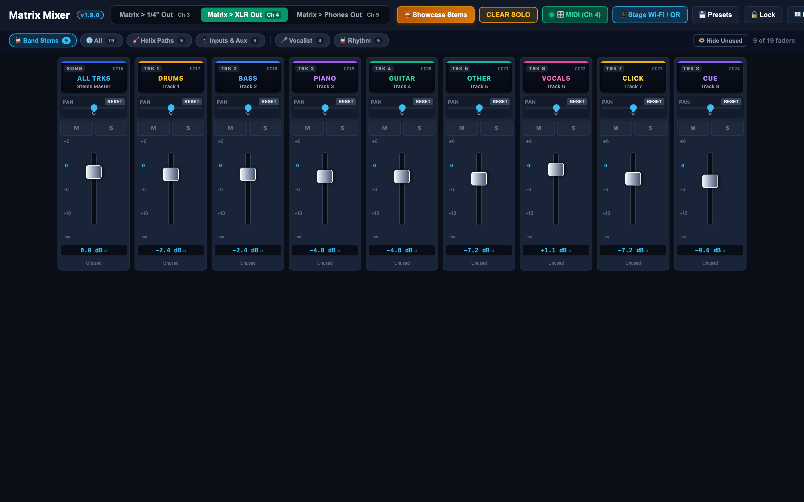
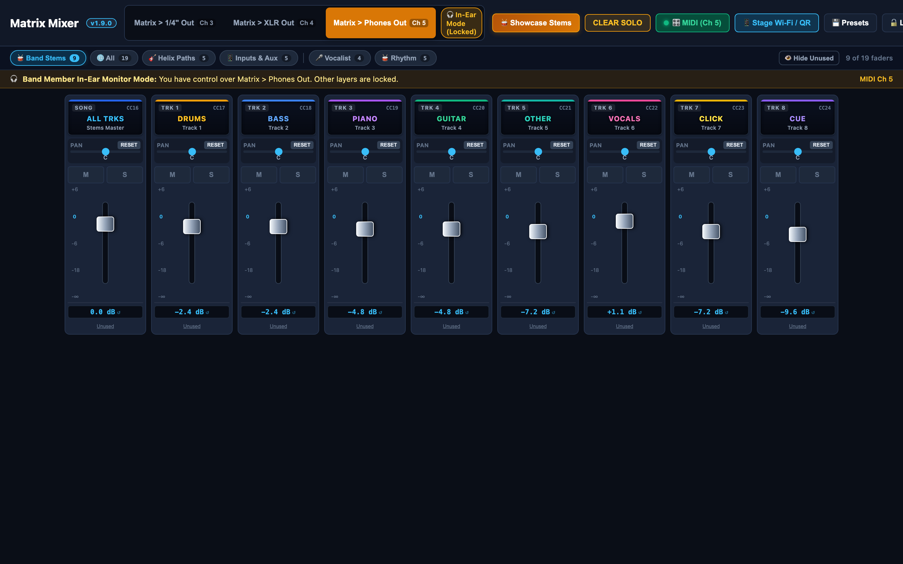

# Helix Stadium 1.4 - Matrix Mixer Desktop 🎛️⚡

Portable, cross-platform Desktop Controller & Stage Wi-Fi Hub for the **Line 6 Helix Stadium 1.4 Matrix Mixer**.

Runs directly on **macOS** and **Windows** without requiring an external MySQL server, cloud service, or command-line dependencies.

---

## 📦 Ready-to-Use Portable Builds

Both builds are generated in `release/`:

* 🍏 **macOS:** [`Helix Matrix Mixer-1.9.0-arm64.dmg`](release/Helix Matrix Mixer-1.9.0-arm64.dmg)  
  *Open and drag to Applications, or run directly.*
* 🪟 **Windows Portable:** [`Helix Matrix Mixer-1.9.0-win.zip`](release/Helix%20Matrix%20Mixer-1.9.0-win.zip)  
  *Extract to any folder or USB stick and run `Helix Matrix Mixer.exe`. No installation required.*

---

## 🌟 Stage Architecture

```
[ AIRSTEP Footswitch ] ──(CME WIDI Wireless)──► [ Line 6 Helix Stadium ]
                                                        │
                                                 (USB MIDI Cable)
                                                        ▼
                              ┌─────────────────────────────────────────┐
                              │  Stage Laptop (MacBook or Windows PC)   │
                              │  ↳ Helix Matrix Mixer Desktop           │
                              │    • Direct USB MIDI to Helix Stadium   │
                              │    • Embedded Zero-Config Stage Server  │
                              │    • Local JSON storage (No MySQL)      │
                              └────────────────────┬────────────────────┘
                                                   │
                                     Local Stage Wi-Fi Router
                                                   │
                                ┌──────────────────┴──────────────────┐
                                ▼                                     ▼
                       [ FOH Sound Engineer ]                   [ Band Members ]
                    (iPad, Mac, Windows at FOH)             (iPhones / Smartphones)
                     ↳ Full 3-Layer Console Strip            ↳ Personal IEM (Phones)
```

---

## 🔐 Role-Based Access Control (RBAC)

The application enforces 3 roles across both client UI and server API endpoints:

### 1. ⚡ Administrator (`ADMIN`)
Full administrative access across all 3 matrix layers (1/4" Line, XLR, Phones), preset management (including deletion), server USB CoreMIDI device switching, and system settings.


### 2. 🎛️ FOH Sound Engineer (`OPERATOR`)
Full real-time audio operator control across all 3 layers: faders, pan, mute, solo, and preset recall & creation. Hardware USB remapping and preset deletion are protected.



### 3. 🎧 Band Member (`BAND_MEMBER`)
Stage safety mode: automatically locked into the **Phones Out** (In-Ear Monitor) layer. Other matrix layers (1/4" & XLR) and preset management are locked to prevent accidental interference with FOH sound.



---

## 🛠️ Build Commands

```bash
# Build frontend, server and Electron entry
npm run build

# Package macOS DMG
npm run dist:mac

# Package Windows Portable
npm run dist:win
```
